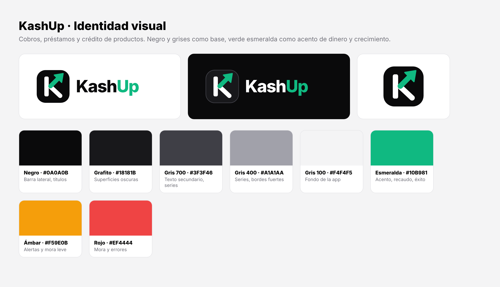

# KashUp · Identidad visual

## Logotipo
| Archivo | Uso |
|---|---|
| `src/assets/kashup-horizontal.svg` | Fondos claros (login, documentos, PDF) |
| `src/assets/kashup-horizontal-fondo-oscuro.svg` | Fondos oscuros (barra lateral) |
| `src/assets/kashup-simbolo.svg` | Ícono de la app, favicon, avatar de redes |

El símbolo es una **K** cuyo brazo superior se convierte en una flecha que sube: el dinero que vuelve y crece.

## Paleta
| Nombre | Hex | Uso |
|---|---|---|
| Negro | `#0A0A0B` | Barra lateral, títulos |
| Grafito | `#18181B` | Superficies oscuras, serie "colocado" |
| Gris 700 | `#3F3F46` | Texto secundario |
| Gris 400 | `#A1A1AA` | Serie "pendiente", bordes fuertes |
| Gris 100 | `#F4F4F5` | Fondo de la app |
| Esmeralda | `#10B981` | Acento, recaudo, éxito |
| Ámbar | `#F59E0B` | Alertas, mora leve |
| Rojo | `#EF4444` | Mora, errores |

Tipografía: **Inter** (400, 500, 600, 700, 800).

Los tokens viven en `src/styles/tokens.css` y los colores de las gráficas en `src/utils/brand.js`.
